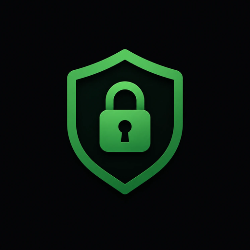

# PassMan for Windows

A local desktop password manager for Windows. Your vault is a single
AES-256-GCM encrypted file. There is no account and no service behind it: it
works entirely offline, and if you want two PCs in step you run the sync
server yourself, on your own hardware.

PassMan lives in four repositories:

| Repository | What it holds |
|---|---|
| **PassMan-Client-Windows** (this one) | the app for Windows, and its installer |
| [PassMan-Client-Linux](https://github.com/usermaneGermane/PassMan-Client-Linux) | the app for Linux — not written yet |
| [PassMan-Server-Windows](https://github.com/usermaneGermane/PassMan-Server-Windows) | the sync server for Windows, and its installer |
| [PassMan-Server-Linux](https://github.com/usermaneGermane/PassMan-Server-Linux) | the sync server for Linux (systemd) |



## Running it

The repository does not contain the app itself. Build it with the
[PassMan Builder](#building-it-yourself-windows), or take it from the
[Releases](https://github.com/usermaneGermane/PassMan-Client-Windows/releases) page when one
has been published.

**`PassMan-Client-Installer.exe`** installs it. Run it and choose a folder
(by default `%LOCALAPPDATA%\Programs\PassMan`) and whether you want a
desktop shortcut. It needs Windows 10 or 11 (64-bit) and installs for your
Windows user only, so it needs no admin rights. You get a Start Menu entry
and an uninstaller under Settings → Apps; the program it installs is
`PassMan.exe`. The vault lives in **`%APPDATA%\PassMan`**, not in the
program folder, so upgrading or uninstalling never touches it.

If you used the portable `PassMan.exe` of 2.2 or earlier, the installer can
move your vaults across. They are moved, not copied, and a vault already in
`%APPDATA%\PassMan` is never overwritten. The portable single-file exe is
no longer made: it unpacked itself to a temporary folder on every launch,
which made it slow to start.

The optional sync server is a separate download from its own repository:
**`PassMan-Server-Installer.exe`** from [PassMan-Server-Windows](https://github.com/usermaneGermane/PassMan-Server-Windows), or a Python script and a
systemd unit from [PassMan-Server-Linux](https://github.com/usermaneGermane/PassMan-Server-Linux). The app never needs it, and it never needs the
app.

To run from source:

```
pip install -r requirements.txt
python sourceFiles/gui.py
```

## Building it yourself (Windows)

Run **`PassMan-Builder.exe`** from the project folder. It is on the
[Releases](https://github.com/usermaneGermane/PassMan-Client-Windows/releases) page, or
can be built from the source, see below. It shows a checklist of what the
build needs:

- the PassMan source files
- Python 3 and its `tkinter`
- PassMan's libraries (`requirements.txt`)
- PyInstaller
- that the app imports cleanly
- Inno Setup 6, for the installer

**Install missing** installs whatever is missing, asking before each one:

- **pip** installs the Python packages.
- **winget** installs Python 3.13 and Inno Setup 6, for your Windows user
  only.

`tkinter` is the one thing it cannot install. It ships with Python, so if
it is reported missing, re-run the Python installer, choose **Modify**,
and tick **tcl/tk and IDLE**.

When every line is ✓, press **Build**. About a minute later the project
folder holds the installer, `PassMan-Client-Installer.exe`. The version
comes from `sourceFiles/version.py`.

The builder does not compile anything itself. It drives the Python
installed on the PC, which is why Python is on the checklist. It prefers
the `py` launcher's newest Python 3 over a bare `python` on `PATH`, which
is often a virtualenv or the Microsoft Store placeholder. It never touches
an installed or running PassMan: everything it writes is in the project
folder.

The same steps run in a terminal, without the window:

```
py builder\build.py                      check, then build
py builder\build.py --install-missing    install what is missing first
py builder\build.py --builder            build PassMan-Builder.exe itself
```

The last line is how the builder is made in the first place, so a fresh
checkout needs Python with PyInstaller once.

### Which files the build needs

PyInstaller compiles the source; the builder only checks and drives it.
Copy the **whole project folder** to the other PC. The build needs:

```
requirements.txt
sourceFiles\    (all of it)
installer\      (for PassMan-Client-Installer.exe)
```

`README.md` is not needed to build, and neither are the `tests` folders.

Watch out: if one of the `.py` files is missing, **PyInstaller still
reports a successful build** and produces an exe that crashes on launch
with `ModuleNotFoundError`. The builder imports the app first, to catch
that while the error is still readable.

### After the build

The installer is self-contained: what it installs bundles Python and
every library, so the target PC does not need Python installed to *run*
PassMan. Python is only needed to *build* it.

The exe is not code-signed, so Windows SmartScreen will likely warn the first
time — "More info" then "Run anyway".

Your passwords do **not** travel with the installer. The vault lives in
`%APPDATA%\PassMan`, so a fresh install on a new PC starts empty. To bring
your logins across, use *Restore from server* if you sync, or copy
`vault\<user>.vault.enc` into `%APPDATA%\PassMan\vault` on the new PC, or
use Settings → *Save encrypted backup* and copy that file over. The backup is still protected by
your master password.

## Project layout

```
PassMan-Client-Windows/
├── builder/            PassMan Builder: build.py, its window, its spec
├── PassMan-Builder.exe  the builder (not committed; see Releases)
├── PassMan-Client-Installer.exe  installs the app (built, not committed)
├── vault/               vaults when running from source - never committed
├── installer/           the Inno Setup script for the installer
└── sourceFiles/         the program itself
    ├── gui.py           app shell: login, account list, lifecycle
    ├── dialogs.py       the modal dialogs
    ├── sync.py          three-way merge; pure functions, no I/O
    ├── sync_client.py   talking to the sync server
    ├── sync_ui.py       the sync, conflict and archive screens
    ├── history_ui.py    the revision history drop-down on each entry
    ├── widgets.py       reusable widgets and modal plumbing
    ├── theme.py         palette, fonts, asset lookup
    ├── vault.py         atomic file handling, schema validation, export
    ├── crypto_utils.py  container format, key derivation, encrypt/decrypt
    ├── importers.py     CSV/JSON parsing from other password managers
    ├── appconfig.py     non-secret preferences
    ├── lockout.py       rate limiting of master-password attempts
    ├── password_generator.py
    ├── version.py       the version shown in the UI
    ├── PassMan-installer.spec  the PyInstaller build the installer ships
    ├── build_version.py the exe's version resource, read from version.py
    └── tests/
        └── sync_server/ a copy of the server, for the end-to-end sync tests
```

## Upgrading from an earlier build

**Back up your vault before you upgrade.** Copy your `vault` folder (called
`data` in earlier versions) somewhere safe, or open the old app and use Settings → *Save encrypted
backup* if it has one.

The upgrade is one-way. This version reads vaults written by older builds and
transparently re-encrypts them at the stronger settings on first unlock —
but once that has happened, **an older PassMan.exe can no longer open the
vault**. It reports "Decryption failed. Wrong password or corrupted data.",
which looks alarmingly like a lost password even though the data is fine.

So: upgrade, confirm your accounts are all there, and only then delete the
old executable. Do not keep both versions pointing at the same vault folder.

### To 2.0 (sync, archive, revision history)

2.0 adds fields to every entry — an id, the archive flag, revision history.
The container is unchanged, so **a 1.x build still opens a 2.0 vault, but
silently drops those fields when it saves**: archived entries come back as
live ones, revision history is lost, and the lost ids confuse the next sync.
So once any PC runs 2.0:

- update **every** PC to 2.0 before using it, and keep no 1.x executable
  pointing at that vault folder;
- update the sync server too (see "Updating" in [PassMan-Server-Windows](https://github.com/usermaneGermane/PassMan-Server-Windows) or [PassMan-Server-Linux](https://github.com/usermaneGermane/PassMan-Server-Linux)).

## Syncing two PCs

Point both PCs at a server you run — [PassMan-Server-Windows](https://github.com/usermaneGermane/PassMan-Server-Windows) or [PassMan-Server-Linux](https://github.com/usermaneGermane/PassMan-Server-Linux) says how to set one
up — then press **Sync**. The vault is encrypted before it leaves
your machine, so the server stores ciphertext it has no key for and never sees
your master password.

- **First PC:** Settings → Sync, enter the address and token, press **Save &
  sync**. It checks the connection first and only stores the settings once
  the server has answered, so a typo in the address cannot leave you thinking
  sync is set up when it is not. *Save only* stores them without contacting
  anything, for when the server cannot be reached right now; *Test
  connection* checks without syncing and tells you whether the next sync will
  upload or merge.
- **Second PC:** *Restore from server* on the login screen pulls the vault
  down. After that, Sync on either machine.

Sync is manual and merges per entry. A change made on only one PC is taken
silently — there is nothing to decide. Only when the **same entry changed on
both** PCs since they last synced do you get a dialog showing both versions
side by side, and **whichever side you do not keep is saved in that entry's
history** — every outcome is reversible with one click on *Revert*.
Cancelling it changes nothing on either side.

**More than one vault.** Each PassMan user syncs as its own, independent vault
on the server, matched across PCs by username (exactly, including case). Set
up sync once per vault, while that vault is unlocked; Sync only ever syncs
the vault that is open.

**If the server's address changes**, update it in Settings → Sync on every
PC — once per vault, because the address is stored inside each vault. Keep
the token as it is. A DHCP reservation for the server in your router stops
this happening by surprise.

### Changing the master password of a vault you sync

Change it as usual in Settings → *Change master password*. On that PC:

- the vault, its backup and its sync state are re-encrypted, and
- **the server is updated straight away**, merging anything your other PCs
  sent first. The option to delete the server's older copies is ticked by
  default, because those copies still open with the old password.

On each **other PC**, the next Sync says the password was changed on another
PC and asks for the new one. Enter it and that PC switches over: from then
on you unlock the vault there with the new password too. Anything it had not
synced yet is merged, not lost.

**Changed it while the server was unreachable?** Nothing is lost. The next
Sync on that PC asks once for your *previous* password, reads the server's
copy with it, and uploads everything under the new one.

**Changed it on two PCs before either synced?** Whichever reached the server
first wins. The other PC is asked for that password and switches to it.

This needs the server to be up to date — update it (see "Updating" in its
README) before changing a password.

To do it without a server at all, Syncthing or a USB stick work: both PCs
just need to see the same `vault` folder, and `PASSMAN_DATA_DIR` can point
the app at a network share.

### Deleting is archiving

The ✕ on an entry moves it to the **Archive** (bottom of the window) instead
of destroying it. Archived entries keep their passwords and can be restored
with one click. *Delete permanently*, inside the archive, is the only action
that really destroys a password.

This is not only an undo. A removal has to be distinguishable from an
addition when two vaults merge, or every entry you delete on one PC comes
back from the other on the next sync.

### Revision history

Every edit keeps the version it replaces. **History** on an entry opens its
earlier versions, newest first, with the date and what changed:

- **Show** / **Copy** an earlier password — handy when a site still has the
  old one. Copies clear from the clipboard after 30 seconds, as usual.
- **Revert** makes that version current again. The version you leave is kept
  in history too, so a revert can itself be undone.
- **Clear history** forgets them, here and on your other PCs at their next
  sync.

All fields are tracked — site, username, password, notes and 2FA — and the
last **10** versions of each entry are kept. Saving without changing anything
records nothing.

History syncs, and never causes a conflict: each PC ends up with the
combined history from both sides. When you settle a sync conflict, the
version you do not keep becomes the entry's newest revision.

**Update every PC** before relying on it: an older PassMan does not know the
field, drops it when it saves, and that loss would then sync. The server
needs no update for this.

## Features

- AES-256-GCM encryption with a PBKDF2-HMAC-SHA256 derived key
- Sync between machines through a server you host, with per-entry merging
- Sort the list by date modified or by name (the *Sort* menu, bottom right);
  the choice is remembered
- Archive with restore, so a deletion is recoverable
- Revision history per entry: the last 10 versions, with show, copy and revert
- Password generator with adjustable length and character classes
- Strength meter that accounts for repetition, sequences and common passwords
- Import from Chrome, KeePass, LastPass, Bitwarden and other CSV/JSON exports,
  carrying notes and TOTP secrets across
- Encrypted backups, plus a plaintext export for migrating away
- Clipboard auto-clear, idle auto-lock, and a delay after repeated wrong
  master passwords

## Important: your master password cannot be recovered

The master password *is* the encryption key. Nobody — including whoever wrote
this app — can decrypt your vault without it, and there is no reset, no
recovery code and no backdoor. If you forget it, the passwords are gone.

**Make backups.** Settings → *Save encrypted backup* writes a copy that is
still protected by your master password, so it is safe to keep on another
drive or in cloud storage.

## Where your data lives

The files below are in `%APPDATA%\PassMan`. An installed copy is
recognised by the `installed` file that the installer puts next to its exe;
without it — running from source, or a portable exe from 2.2 or earlier —
they are next to the program instead.

| File | What it is |
| --- | --- |
| `vault/<user>.vault.enc` | your encrypted vault |
| `vault/<user>.vault.enc.bak` | the previous version, kept automatically |
| `vault/<user>.vault.enc.base` | what the server held at the last sync; only if you sync |
| `config.json` | non-secret preferences (last username, auto-lock delay) |

The `.base` file is how merging tells a deletion apart from an addition. It
is encrypted with the same master password as the vault. Deleting it is safe
— the next sync just asks more questions than it needs to. Changing your
master password deletes it automatically, since it cannot be re-encrypted
without the old one.

This folder used to be called `data`. If you already have one, PassMan keeps
using it as-is and creates nothing new — rename it to `vault` yourself when
convenient, while the app is closed.

Vault writes go to a temporary file and are then atomically renamed into
place, so an interrupted save (full disk, power cut) cannot corrupt the vault.
If the main file is ever damaged, PassMan falls back to the `.bak` copy.

## Vault format

```
base64( "PMV2" || kdf_id(1) || iterations(4) || salt(16) || nonce(12) || ciphertext )
```

The 9-byte header is passed to AES-GCM as additional authenticated data, so the
stored KDF parameters are covered by the authentication tag and cannot be
tampered with. New vaults use 600,000 PBKDF2 iterations; because the count
travels in the header, it can be raised later without breaking existing
vaults. Vaults written before this header existed are still read, and are
transparently re-encrypted at the current cost the next time you unlock.

## Security notes and limits

Worth knowing about, in the interest of not overselling this:

- **PBKDF2 is not memory-hard.** A memory-hard KDF (Argon2id, scrypt) resists
  GPU cracking better. The format header exists so that migration is possible
  without breaking anyone's vault.
- **The unlocked vault lives in memory in the clear**, and Python strings
  cannot be reliably wiped. Auto-lock limits the window; it does not close it.
- **Clipboard auto-clear only clears the live clipboard.** Windows clipboard
  history (Win+V) and cloud clipboard sync keep copies no application can
  reach. Turn them off if that matters to you.
- **TOTP secrets are stored, not used.** An imported 2FA seed is kept so a
  migration does not lose it, but PassMan does not generate codes from it —
  keep using your authenticator app. Card details, custom fields and
  attachments in an export are still not imported; PassMan warns when it
  sees them.
- **The unlock delay is a speed bump, not a boundary.** It slows guessing at
  the login screen and survives a restart, but anyone who can copy the vault
  file can attack it offline with no limit at all. Deleting `config.json`
  clears a penalty.
- **Archived entries still hold live passwords.** If you retire a login
  because the password leaked, archiving is not enough — use *Delete
  permanently* in the archive view.
- **Revision history keeps old passwords.** Up to 10 per entry, encrypted
  with the rest of the vault. Old passwords are often reused elsewhere or
  hint at your patterns, so if one leaked, use *Clear history* on that entry
  — it reaches your other PCs too. *Delete permanently* removes an entry's
  history with it.
- **The sync token is a single trust boundary.** Anyone holding it can read
  and overwrite every blob on your server. It is stored inside the vault,
  which is encrypted, rather than in `config.json`, which is not — but it is
  one shared secret, not per-user access control.
- **The sync server is not a backup.** It holds one copy of a file your PCs
  also hold, and it will happily store a vault you damaged. It does keep the
  last 20 revisions, which is a safety net, not a backup strategy.
- **Changing the master password does not re-lock existing copies.** Encrypted
  backups you saved and a vault on a lost USB stick still open with the
  password they were written under, and so does the server's history unless
  you leave *delete the older copies* ticked when you change it. If you
  change it because the old one leaked, change the passwords *inside* the
  vault too — starting with email and banking.
- **This has not been independently audited.**

## Versioning

The version shown in the UI lives in `version.py`. Bump `__version__` there on
release; `VAULT_FORMAT` tracks the on-disk container (`crypto_utils.MAGIC`) and
a test fails if the two drift apart.

Bump the **major** version when an older build can no longer safely use what
this one writes — even if the container stays `PMV2`, as in 2.0, where 1.x
would silently drop the new entry fields. New features that older builds
handle harmlessly are a minor bump; fixes are a patch.

## Development

```
pip install -r requirements-dev.txt
python -m pytest -q
```

See the project layout above for what each module does. `gui.py` is
presentation only and never touches the cipher.

Tests point `PASSMAN_DATA_DIR` at a temporary directory, so running them
never touches a real vault.

`test_sync_server.py` syncs two simulated PCs through a real server on a
free port. The server is a copy in `sourceFiles/tests/sync_server/`; refresh
it from the server repository when the server changes (its README says
how).

GitHub Actions runs the same tests on Windows with Python 3.12 and 3.13 for
every pull request and every push to `main`
(`.github/workflows/tests.yml`).
